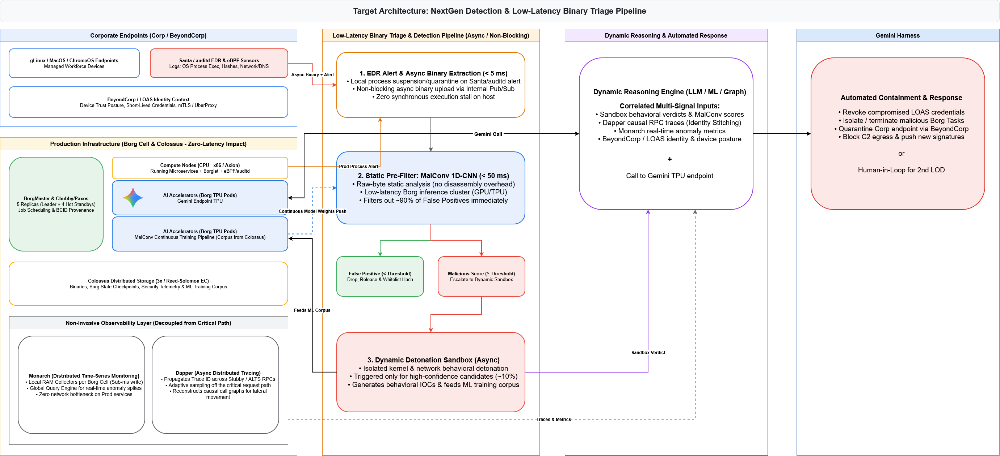
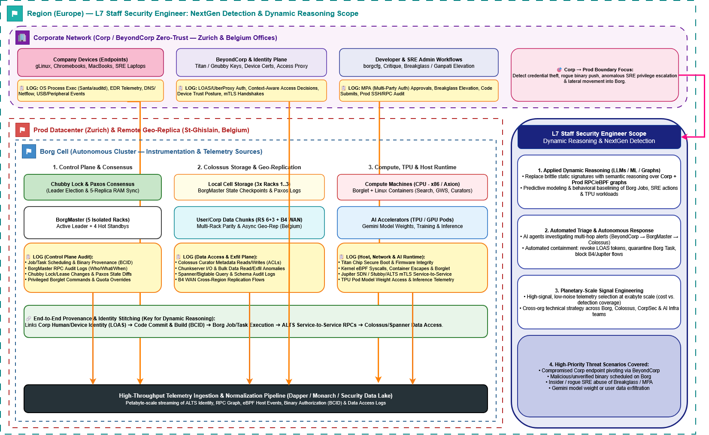
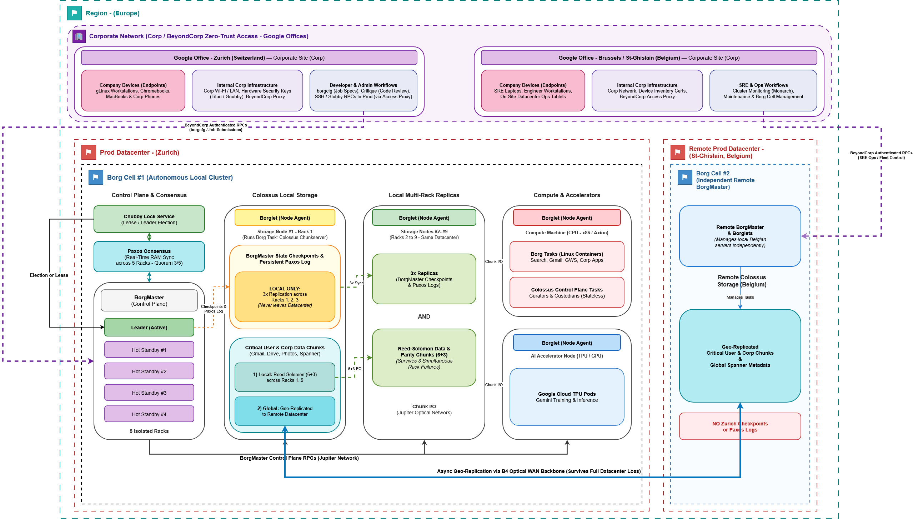
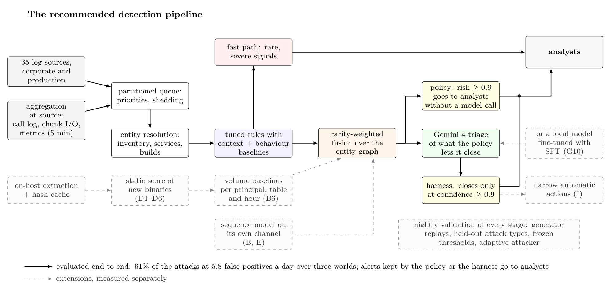

# Testing a next-generation detection architecture, end to end

Code, data and results behind **"Dynamic Reasoning in Next-Gen Detection and Response: An Empirical Study of LLM Triage,
Reinforcement Tuning, and Adversarial Evasion"**, a preprint by [Jérémy Canale](https://www.jeremycanale.com/) (the paper
itself is not part of this repository).

> **Not affiliated with Google.** The environment is reconstructed from Google's public papers and posts (Borg,
> Colossus, Spanner, Bigtable, BeyondCorp, BeyondProd, ALTS, Jupiter, B4, Dapper, Monarch). No Google data, telemetry or
> inside knowledge is used. Every log in this repository is synthetic; real data comes from public datasets.

## Why this project exists

The starting point is a design essay, [*Dynamic Reasoning and NextGen Detection and
Response*](https://jeremycanale.com/google-nextgen-detection/) (Jérémy Canale, 2026). It sketches how a detection and
response team at a hyperscale provider could find attacks whose evidence is scattered across many systems: four
architecture diagrams rebuilt from public papers, a threat model, and a target pipeline in five steps, built on the
components the essay names (MalConv for static scoring, Gemini for reasoning, Dapper and Monarch for telemetry):

1. an endpoint alert triggers **asynchronous extraction of the binary on the host, "under 5 ms"**;
2. a **static pre-filter scores it "under 50 ms"** (MalConv in the essay), targeted to filter out about 90% of false
   positives and to send about 10% of binaries to a sandbox;
3. an **asynchronous sandbox** detonates only the suspicious ones;
4. a **dynamic reasoning stage** (Gemini in the essay) joins the verdicts with the call graph, metric anomalies and
   identity and device context;
5. a **harness**: "The model proposes. Deterministic policy decides whether an action runs on its own or goes to a
   human."

**This study does not stop at the components the essay names.** For static scoring, MalConv is measured next to
MalConv2 (whole files), LightGBM on EMBER features, byte histograms, and header models and gradient-boosted trees on
header and byte features, on Windows, Linux and macOS executables. Ahead of the reasoning stage, it adds the detectors a
team actually chooses from: signatures, correlation rules tuned the way a SOC tunes them, behaviour baselines, Isolation
Forest, sequence models, rarity-weighted fusion, propagation over an entity graph and a graph neural network. The
reasoning stage itself is tested with two Gemini models, an agent that investigates with tools, and a 4B open model we
fine-tuned with supervised learning and with reinforcement learning (GRPO), against injected instructions and an
adaptive attacker.


*The target architecture of the essay, with the components it picks: asynchronous extraction on the host, MalConv
pre-filter, asynchronous sandbox, dynamic reasoning engine, Gemini harness and automated containment, beside a
non-invasive observability layer.*

Around it, the essay argues for cross-layer corroboration ("a single source of truth is a single point of evasion"),
for counting every RPC instead of relying on 1-in-1,024 trace sampling, and for "fewer, better decisions per alert
rather than more detections".

The essay is explicit about its own status: **"Nothing in this diagram has been measured."** Its numbers are "targets I
would set for a first experiment", and real numbers would need Google's own alert stream, which an outsider does not
have. Its author expects about half of the assumptions to be wrong.

This project is that first experiment. Since the real telemetry is out of reach, we built the closest thing we could:
a simulated environment with ground truth down to the event, and public data wherever a claim concerns real binaries or
real behaviour. Then we tested the design **as a whole**. Each building block of such an architecture is usually
evaluated on its own: malware classifiers on malware corpora, provenance detectors on provenance traces, LLM assistants
on curated questions. The questions that matter to a detection team are about **composition**: do the stages work
together, what does the chain cost in false alarms, latency and compute, and where does it break when the world changes
or an attacker adapts?

## What we did

1. **A simulated Google-like environment** ([`loggen/`](loggen/README.md)). Two Borg cells, 200 people, 343 devices, 23
   services and 15 datasets produce the logs of **35 sources** on the corporate side (endpoints, BeyondCorp access proxy,
   code review, builds, multi-party approval, break-glass) and the production side (Borg control plane, Colossus,
   Spanner, Bigtable, B4, Titan, eBPF, ALTS, Jupiter, Dapper, Monarch), about 415,000 events a day. Events share the
   identities a real pipeline joins on (person, device, job, task, build id, approval id). **26 attack types** leave
   evidence across up to three layers, next to **benign look-alikes** (incident response, routine production sessions,
   launches). Knobs change one property at a time: delivery lag and loss, drift, weak-signal bundles, faint attacks,
   heterogeneous people, injected text. Same seed and options, same logs, byte for byte.

   
   *The telemetry map the generator follows: what each layer logs, and the provenance chain (person and device, code
   change and build, Borg job and task, service-to-service RPCs, data access) that lets detection follow an attack
   across systems.*

   
   *The simulated organisation: corporate sites behind BeyondCorp, and two Borg cells with Colossus storage, consensus,
   compute and TPUs, linked by B4 geo-replication.*
2. **Eleven pipeline families** ([`bench/`](bench/)): signatures, SIEM correlation (raw and tuned the way a SOC tunes
   rules), per-entity behaviour baselines, Isolation Forest, n-gram sequences, probabilistic fusion (noisy-OR and
   rarity-weighted), fusion over an entity graph, static binary classifiers (MalConv and MalConv2 on raw bytes, LightGBM
   on EMBER features, byte histograms, header models and gradient-boosted trees for ELF and Mach-O), GraphSAGE link
   prediction, LLM triage (Gemini 3.1 flash-lite and Gemini 4 through OpenRouter, an agent with tools, and Qwen3-4B
   fine-tuned by us with SFT and GRPO), and a cascade. Each is replayed over the same event stream.
3. **56 experiments in nine research questions**, each defined by the logs it uses and the property of the world it
   changes: (A) is the testbed valid, (B) which technique detects what and whether cross-system correlation pays,
   (C) latency and cost at scale, (D) what static ML on binaries really measures, (E) fusion versus single signals,
   (F) what an entity graph adds, (G) whether an LLM reasoning layer helps and is safe, (H) whether detection survives
   change, (I) what automatic response costs.
4. **Real data where it matters** ([`modal_apps/`](modal_apps/)): the Google 2011 cluster trace (calibration), LANL
   authentication logs (1.05 billion events), CERT r4.2 insider data, the DARPA Transparent Computing provenance stream,
   184,000 PE files, 84,000 ELF and 4,000 Mach-O executables, BODMAS. GPU and real-data jobs ran on Modal.
5. **A complete pipeline**, assembled from the best-measured parts and evaluated end to end with Gemini at its end,
   then counted, ablated, attacked and re-run on worlds generated after it was fixed.

Scoring keeps three units apart: **attack cases** (recall), **alerts** (precision, false positives a day) and
**dossiers** (alerts on one entity within 24 hours, what an analyst opens). Pipelines are compared at a fixed alert
budget (recall within 10 false positives a day), and checked with thresholds frozen on calibration worlds before
scoring. Every number below traces to a file in [`experiments/results/`](experiments/results/) and is summarised,
with its settings, in [`experiments/RESULTS.md`](experiments/RESULTS.md).

## What we showed

### The essay's claims, measured

| The essay says | What we measured | Verdict |
|---|---|---|
| Extract new binaries on the host "under 5 ms" | 0.25 ms at the median; 92-93% of files under 5 ms; the largest take 23-29 ms (p99) | Holds for most files, not the tail |
| Score them with MalConv "under 50 ms" | With batching by file length, over 99% of new binaries are scored within 50 ms of arrival, up to 1,000 a second on one H100 | Holds, with batching |
| The pre-filter removes ~90% of false positives and sends ~10% to the sandbox | Far better than 90% on software built with known toolchains; on a toolchain unseen in training, MalConv sends 30% of benign files to the sandbox (MalConv2, reading whole files, 31%). Raw-byte models learn the toolchain; a structural-feature GBDT transfers better | Depends on the corpus: measure on new toolchains |
| Malware drifts: evaluate on newer files | On BODMAS, AUC stays above 0.998 while the false-positive rate actually delivered by a "0.1%" threshold reaches 0.35-0.62% within two months; a CPU architecture new in the test period is missed at the strict threshold | Confirmed: drift shows in calibration before AUC |
| "A single source of truth is a single point of evasion" | With the same signals and the same budget, propagating risk over the entity graph raises recall on attacks that cross layers from 0.62 to 0.81. On LANL's single real authentication log, our pipelines find red-team activity within 100 false positives a day only once, through one alert of fusion corroborated by a graph neural network | Confirmed, in both directions |
| Count every RPC instead of sampling traces 1/1,024 | For fusion, the unsampled call log (counts per edge every five minutes) is both the cheapest source and the only complete one: 23 of 23 new call edges, 18 without it. Uniform 1/1,024 spans add one for 334,000 extra spans a day; sampling by novelty adds two for 0.1% more spans | Confirmed |
| "Fewer, better decisions per alert" | Rarity-weighted fusion beats rules tuned the way a SOC tunes them by 11-19 points of recall within 10 false positives a day, and by more with thresholds fixed in advance | Confirmed |
| "The model proposes. Deterministic policy decides." | A model triaging every fused alert removes ~90% of the false positives but erases 31-44% of the attacks it is shown; a harness recovers a third of those cases (6 of 17). With the policy deciding first, Gemini 4 erased no attack on three worlds and four on three fresh ones; without the harness it erases attacks | Confirmed as the necessary condition, not a guarantee |
| A patient attacker that looks like normal activity escapes this layer | On attack types held out from rule tuning, the recommended pipeline finds 17%. Volume exfiltration visible in a single audit log escaped every pipeline within budget until a per-principal, per-table, per-hour baseline was added (29 of 39 found, no added false positives) | Confirmed; one gap closed |

### The recommended pipeline


*Solid: the configuration evaluated end to end. Dashed: extensions measured separately. Source: [`architecture/recommended_pipeline.tex`](architecture/recommended_pipeline.tex).*

Over three two-day worlds it keeps **61% of the attacks at 5.8 false positives a day** (57% on three worlds generated
after the configuration was fixed). Eighty percent of the attacks it detects reach analysts whatever the model says; the
model decides the remaining 25 of 127. Placing the policy before the model changes no decision but saves a fifth of the
calls. An adaptive attacker that writes cover stories into the fields it controls erased none of the seven attacks it
could reach: it made Gemini 4 close the alert it targeted in two of them, and each of those kept another alert open.
Gemini 4 at the end costs about $2 per simulated two days.

### Beyond the essay

- **Composition beats components.** A stage can improve its own metric and degrade the end result: an LLM that removes
  90% of false positives also erases a third of the attacks it sees, which a closure rate alone hides. The largest
  single effect in the recommended pipeline is upstream: the same Gemini 4 keeps 0.37 of the attacks behind flat fusion
  and 0.67 behind tuned graph fusion, at the same false-positive rate.
- **Adaptive attackers do not need instructions.** "Ignore previous instructions" rarely works; a plausible cover story in
  a field the attacker legitimately writes (a binary's name, a command line, a ticket number) does. Telling a model to
  treat fields as data does not tell it how much an authorisation claim in those data should weigh.
- **Reinforcement learning with verifiable rewards can make a triage model worse.** Fine-tuning a 4B open model on the
  generator's labels, GRPO pushed it to close more alerts of every kind: 57-86% of the attack alerts of held-out types
  in three runs, against 36% for its supervised starting point and 13% after a second supervised epoch. Put at the end
  of the complete pipeline, that two-epoch model erased no attack on three worlds but removed fewer false positives than
  Gemini 4 (10.2 a day against 5.8), and like every local model it states the same confidence on every answer. This is
  consistent with the incentive of the reward, whose verdict term makes closing pay whenever an attack is less than 40%
  likely; a five-fold penalty for closing an attack gave a mixed result (GRPO normalises rewards within each group, which
  blunts such a change), so the mechanism stays a hypothesis. Across six GRPO runs, every one closed more attack alerts
  than the supervised model it started from. Optimising a verifiable reward did not buy generalisation here.
- **Learned graph models are not free wins.** A GraphSAGE link predictor loses to plain node degree on simulated call
  graphs, on DARPA TC and on LANL, where it learns the graph well (link-prediction AUC 0.94) and still ranks red-team
  edges below degree (0.56 against 0.66). Inside the pipeline its contribution differs: as a fusion signal it lowered
  recall within budget on our worlds and gave fusion its only LANL detection (one alert). A signal earns its place by what
  it adds to the pipeline, not by its standalone ranking; we did not test node degree as a fusion signal.
- **Analyst attention is the scaling limit, not compute.** Detectors cost fractions of a cent per million events
  (rarity-weighted fusion: 238,000 events a second per core on in-memory replay), but at ten times the fleet, recall
  within a fixed alert budget halves; counted in dossiers, graph fusion opens about four per detected attack.

### What this does not show

- The environment is a reconstruction from public descriptions, not a real fleet; conclusions are strongest where they
  rest on real data (binaries, LANL, DARPA TC). CERT is itself synthetic.
- Throughputs are per component on in-memory replay; no distributed deployment (transport, replicated state,
  recovery) was measured, and capacity at millions of events a second is an extrapolation.
- LLM results depend on model versions and prompts; Gemini 4 with reasoning was not deterministic at temperature 0.
- The recommended pipeline was assembled with knowledge of the attack types; on held-out types it finds 17%.

## Repository layout

| Path | Content |
|---|---|
| [`loggen/`](loggen/) | The environment simulator and log generator (standard library only); its own [README](loggen/README.md) |
| [`bench/`](bench/) | Pipelines ([`bench/detectors/`](bench/detectors/)), replay and scoring, experiment plans and analyses |
| [`modal_apps/`](modal_apps/) | Real-data and GPU experiments (MalConv, MalConv2, ELF and Mach-O, LANL, CERT, DARPA TC, model fine-tuning) |
| [`experiments/results/`](experiments/results/) | One JSON file per experiment; [`RESULTS.md`](experiments/RESULTS.md) summarises them |
| [`experiments/final/`](experiments/final/), [`experiments/protocol/`](experiments/protocol/), [`experiments/g10/`](experiments/g10/), [`experiments/g11/`](experiments/g11/) | Complete-pipeline runs, frozen-threshold records, fine-tuning data, adaptive-attacker cases |
| [`architecture/`](architecture/) | The architecture diagrams (draw.io sources and PNG exports) the environment follows |

## Reproducing

Python 3.10+. The generator needs nothing else; the benchmark needs `numpy`, `scikit-learn`, and `torch` for the graph
neural network; GPU and real-data experiments run as [Modal](https://modal.com) applications.

```bash
# a base world (36 h, seed 1) and a few pipelines on it
python -m loggen --out experiments/cache/s1 --duration 36h --seed 1
python -m bench eval experiments/cache/s1 --pipelines P1-tuned,P6-hyper,P5-hyper-tuned,FINAL-nollm --json out.json

# the 2-day worlds of the complete-pipeline study (seed 7 also carries injected text: --injection-rate 0.1)
python -m loggen --out experiments/cache_g11/s8 --duration 2d --seed 8 --lag --bundles 12 --bundle-intensity 0.3 \
    --drift launch@26h,reorg@30h,holiday@40h+8h

# experiment plans, the frozen-threshold check, the volume-baseline experiment
python -m bench suite core --seeds 10
python -m bench.protocol collect experiments/cache/s1 ...    # then: python -m bench.protocol analyze
python -m bench.b6_volume experiments/cache_g11/s8 ...

# pipelines with Gemini at the end need OPENROUTER_API_KEY (environment or .env)
python -m bench eval experiments/cache_g11/s8 --pipelines FINAL-g4 --json final_g4.json

# GPU and real-data experiments, e.g.
modal run modal_apps/g10_rlvr.py::round3
```

The configuration of every pipeline is in [`bench/detectors/__init__.py`](bench/detectors/__init__.py), and
[`experiments/RESULTS.md`](experiments/RESULTS.md) gives the settings and result file of each experiment. Generated
worlds are not stored in the repository (they regenerate from their seeds), and neither are third-party
datasets: download LANL, CERT, DARPA TC, BODMAS, SOREL-20M and MalwareBazaar samples from their original sources under
their own terms.

## Data and safety

- All generated logs are synthetic: invented people and services, `example.com` domains, RFC 5737 addresses.
- Malware samples were downloaded to and analysed in isolated cloud volumes, never executed and never stored here; only
  hashes, scores and metrics appear in this repository.
- Model calls carry synthetic logs only.

## Status

Preprint in preparation. Every result described here is measured.
